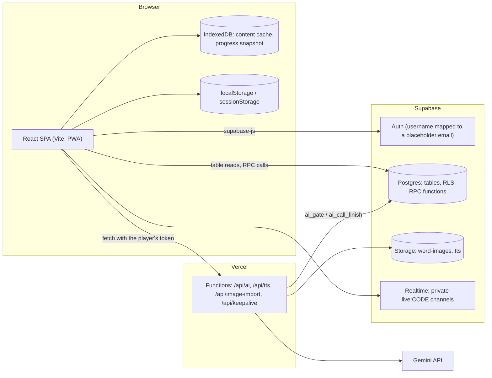
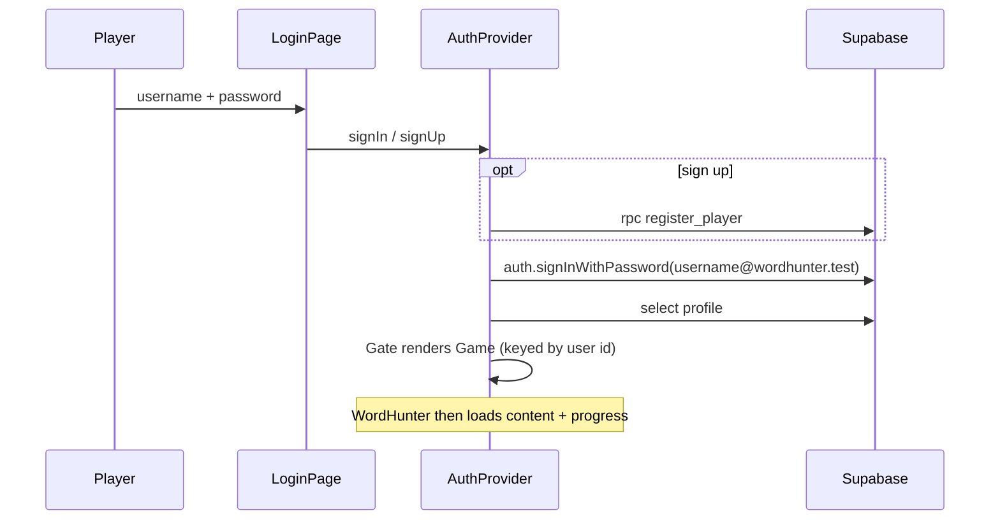
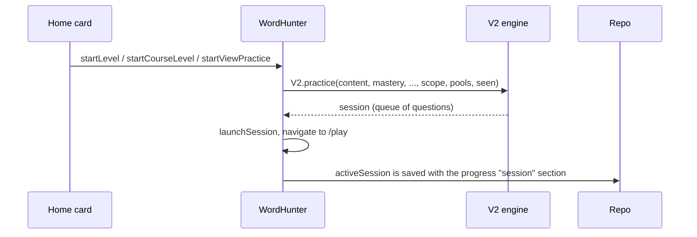
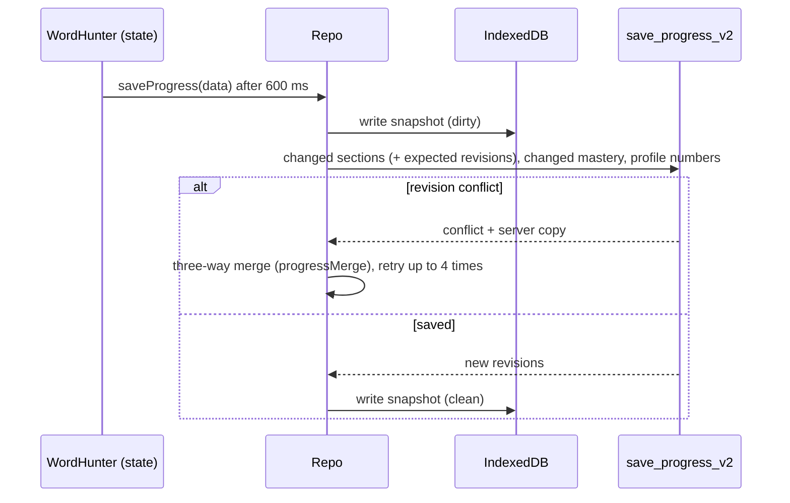

# Word Hunter: current state

A map of how the app works today, read from the code. It is for reviewing and organising the project, not a spec for new behaviour.

- Snapshot: `master` at commit `e4f9c97` (2026-10-15). Re-check against the code before relying on a detail.
- Related: [module-map.md](module-map.md) (proposed module boundaries) and [roadmap.md](roadmap.md) (ranked problems and phased plan).
- Module-level detail: [docs/modules](../README.md).

## How to read this document

Every claim carries one of these labels, either in a column or in the text.

| Label | Meaning |
| --- | --- |
| **Current** | What the code does now. Read from the source. |
| **Confirmed defect** | Shown by running something (a test or a probe on a throwaway database with synthetic data). |
| **Defect (by reading)** | A flaw that follows from the code but was not executed end to end. |
| **Assumption** | Something believed true but not checked. |
| **Not verified** | Could not be checked here (see the end of this file). |

Problem IDs such as `DP-01` point to the register in [roadmap.md](roadmap.md#problem-register).

## 1. System at a glance

**Current.** Two runtime modes share one code base:

- **Online mode** when `VITE_SUPABASE_URL` and `VITE_SUPABASE_ANON_KEY` are set. Accounts, content, progress, library, Live, friends and admin go through Supabase.
- **Local mode** when they are not set ([supabase.js](../../src/lib/supabase.js)). One built-in admin, everything in the browser (IndexedDB and localStorage), AI off. Used for development, unit tests and the browser specs. Library, Live, friends and admin each have a local implementation of the same interface.

Size, for orientation: about 13.8k lines of JS/JSX in `src` and `api` (the biggest file is [WordHunter.jsx](../../src/app/WordHunter.jsx) at about 2,150 lines), 36 SQL migrations, 50 test files, 13 browser specs, 22 SQL test files.

## 2. Entry points

| Entry | File | What it does |
| --- | --- | --- |
| HTML | [index.html](../../index.html) | Hosts `#root`. A service worker and manifest come from `vite-plugin-pwa` ([vite.config.js](../../vite.config.js)). |
| Bootstrap | [main.jsx](../../src/main.jsx) | Renders `App`, Vercel Analytics and Speed Insights, and loads the base styles. |
| App shell | [App.jsx](../../src/app/App.jsx) | Starts loading app settings, then `AuthProvider` and `Gate`. `Gate` shows the splash, the login page, or `Game`. |
| Game | `Game` in App.jsx | Builds the repo (Supabase or local) for the signed-in account and renders `WordHunter`. It is keyed by user id, so switching accounts starts a clean state. |
| Orchestrator | [WordHunter.jsx](../../src/app/WordHunter.jsx) | Loads content and progress, owns almost all game state, picks the screen from the URL. See section 4. |
| Serverless | [api/](../../api) | Four Vercel Functions, see section 5. Routing and caching are set in [vercel.json](../../vercel.json). |
| Cron | `/api/keepalive`, daily 06:17 UTC | Pings Supabase so a free project does not pause. |
| CI | [ci.yml](../../.github/workflows/ci.yml) | Lint, unit tests, build; browser specs; a fresh Postgres with all migrations and SQL tests, then the library contract tests. |

## 3. Screens and routes

Routing is a small History API router ([router.js](../../src/lib/router.js)). `parseRoute` turns a path into a screen; list filters live in the query string. Unknown paths go home.

| Path | Screen id | Rendered by | Main data |
| --- | --- | --- | --- |
| `/`, `/stories` | `levels` | `LessonsView`, `CourseLevelsView`, `HomeTabs`, `MyViewsHome`, `StageCard` under [features/home](../../src/features/home); stories list inline in WordHunter | the levels (built from content), mastery, library keys, view tree |
| `/play` | `play` (inner: `session`, `results`, `finalReport`, `speedResults`...) | [SessionView](../../src/features/session/SessionView.jsx), [ResultScreens](../../src/features/results/ResultScreens.jsx) | the active session in progress state |
| `/stats` | `stats` | [StudyDashboard](../../src/features/stats/StudyDashboard.jsx) | session logs, daily history, mastery |
| `/badges` | `badges` | inline panel in WordHunter | mastery, best streak |
| `/live`, `/live/<code>` | `live` | [LiveChallenge](../../src/features/live/LiveChallenge.jsx) (lazy) | Live RPCs, realtime channel |
| `/leaderboard` | `leaderboard` | [Leaderboard](../../src/features/social/Leaderboard.jsx) (lazy) | `profiles` |
| `/profile` | `profile` | [ProfilePage](../../src/features/social/ProfilePage.jsx) (lazy) | profile, Live history |
| `/friends` | `friends` | [FriendsPage](../../src/features/social/FriendsPage.jsx) (lazy) | friends RPCs |
| `/library` | `library` | [LibraryPage](../../src/features/library/LibraryPage.jsx) (lazy) | library and view RPCs |
| `/catalog` | `catalog` | [CatalogPage](../../src/features/library/CatalogPage.jsx) (lazy) | catalog RPCs |
| `/join/<token>` | `join` | [JoinPage](../../src/features/library/JoinPage.jsx) (lazy) | view link RPCs |
| `/settings` | `settings` | [SettingsPage](../../src/features/settings/SettingsPage.jsx) (lazy) | player settings (in progress) |
| `/data` | `data` | [ImportExport](../../src/features/data/ImportExport.jsx) (lazy) | content and progress files |
| `/admin/<section>/<item>` | `admin` | [AdminPanel](../../src/features/admin/AdminPanel.jsx) (lazy), 14 sections | `admin_*` RPCs, content, audit |

Guards (**Current**): WordHunter redirects home for unknown paths, `/admin` for non-admins, `/play` with nothing to play, and `/leaderboard` when ranks are off. These guards only decide what the UI shows. The real checks are in the database (section 6).

## 4. State management

There is no state library. State lives in these layers, from most global to most local.

| Layer | Where | Holds | Notes |
| --- | --- | --- | --- |
| URL | [router.js](../../src/lib/router.js) (`useSyncExternalStore`) | screen, section, filters | Refresh and shared links work. |
| Auth | [AuthProvider](../../src/features/auth/AuthProvider.jsx) context | session user, profile, sign-in/up/out | Profile cached in localStorage for an offline start. |
| App settings | [appSettings.js](../../src/lib/appSettings.js) external store | sign-ups, maintenance, announcement, AI, Live limits, ranks, defaults | Loaded once at start; cached; read on the login page too. |
| Game state | `useState` and `useRef` inside `WordHunter` | content lists, mastery, pools, confusions, session, settings, reports, score, streaks, library keys, UI flags | About 90 `useState` hooks in one component. Refs mirror some values for use inside callbacks. |
| Game's copy of the content | [features/content/gameContent.js](../../src/features/content/gameContent.js) module value | one object: words, grammar, challenges, level order, levels, badges | Replaced by `setGameContent` with a new object built by `buildCatalog` ([engine/catalog.js](../../src/engine/catalog.js)); only the shell imports it and passes `gameContent()` / `setGameContent` to the features; the engine takes it as an argument. A `dataVersion` counter forces a re-render. `MT-02` fixed. |
| Repo | [repo.js](../../src/lib/repo.js) closure | what the server is known to hold, save queue, status | Decides what to send (diffs) and merges on conflict. |
| Feature hooks | `useLibrary` (called in WordHunter), `useViews`, `useViewScope`, `useSocialCounts` | library API and the key-to-id map, view tree, waiting counts | Local to the screens that use them, except `useLibrary`, whose result WordHunter passes down. |
| AI operations | [aiOperations.js](../../src/lib/aiOperations.js) external store | running and failed AI jobs, cancellation | Drives the AI progress panel. |
| Browser storage | IndexedDB `content-cache`, `progress:<userId>`, `local:*`; localStorage (profile cache, TTS links, admin path, announcement hidden, local-mode library, Live and friends); sessionStorage (local Live player) | caches and local-mode data | Every access is wrapped in try/catch. |

**Current, load order.** After sign-in, `WordHunter` calls `repo.loadContent()` and `repo.loadProgress()` together. If either fails it shows an error with a retry button and does not start from empty progress, so a later save cannot overwrite the real data. After load it applies the data, builds the badge baseline, and starts the save and refresh effects.

**Current, save paths.** Progress saves are debounced (600 ms) and flushed on page hide and sign-out. Content saves (admin only) wait 150 ms and are serialised. Details in [progress](../modules/progress/README.md) and [content](../modules/content/README.md).

## 5. API routes (Vercel Functions)

| Route | Method | Who | What | Server-side checks |
| --- | --- | --- | --- | --- |
| [/api/ai](../../api/ai.js) | POST | player or admin | Sends a prompt to Gemini, returns JSON text | Task name must be in [tasks.js](../../api/_lib/tasks.js) (unknown names refused); prompt size limit per task; admin-only tasks; the database `ai_gate` function checks the token, role, the "AI for players" switch and the daily quota, and logs the call. |
| [/api/tts](../../api/tts.js) | POST | player or admin | Speaks a phrase; stores audio once in the public `tts` bucket and returns its URL | Cached audio is returned without any gate; new audio goes through `ai_gate` (kind `tts`). Only the server key can write the bucket. |
| [/api/image-import](../../api/image-import.js) | POST | admin | Copies an outside picture into `word-images` | `ai_gate` admin-only; public addresses only, 2 MB, magic-byte type check ([publicFetch.js](../../api/_lib/publicFetch.js)). |
| [/api/keepalive](../../api/keepalive.js) | GET | cron | Health pings | Optional `CRON_SECRET`. |

The browser side is [lib/ai.js](../../src/lib/ai.js) (45 s timeout, offline check, token header) and [lib/aiOperations.js](../../src/lib/aiOperations.js). All prompts are written in the browser ([engine/ai.js](../../src/engine/ai.js)); the server forwards the text. See `PE-04`.

## 6. Data layer

### 6.1 Tables by domain

| Domain | Tables | Written by |
| --- | --- | --- |
| Accounts | `auth.users`, `profiles` (role, leaderboard numbers, Live counters), `signup_log` | `register_player`, `save_progress_v2`, Live triggers, admin RPCs |
| App settings | `app_settings` (one row) | `admin_save_settings` |
| Shared content (legacy model) | `content_items` (one row per word, rule, challenge, story, combo; tombstones), `content_meta` (version, level order, note), `content_drafts`, `item_key_aliases` | `content_save_v2` (admin) |
| Player progress | `progress` (sections: core, session, pools, seen, confusions, history, levels, reports; each with a revision), `mastery` (one row per word or item key) | `save_progress_v2`; also direct writes allowed by RLS (`PE-02`) |
| Reports | `reports`, `report_tombstones` | the player (own), admin (all), triggers |
| Dictionary and library (new model) | `headwords`, `senses`, `sense_links`, `grammar_rules`, `grammar_questions`, `collections` (views), `collection_senses`, `collection_rules`, `library_entries`, `library_rules` | `dictionary_sync` (dictionary, official collections), library RPCs (everything personal) |
| Unused progress tables (new model) | `sense_progress`, `rule_progress` | nothing (`DP-06`) |
| Sharing | `collection_shares`, `view_links`, `view_link_takes`, `catalog_entries`, `catalog_takes` | share, link and catalog RPCs |
| Live | `live_challenges`, `live_answer_keys`, `live_players`, `live_answers`, `live_results` | Live RPCs and triggers |
| Friends | `friendships`, `live_invites` | friend and invite RPCs |
| AI | `ai_usage`, `ai_calls` | `ai_gate`; `ai_call_finish` (server key only) |
| Audit and analytics | `admin_audit`, schema `analytics` (views) | triggers, `admin_*` RPCs |

### 6.2 Access rule

**Current.** Reads use row-level security; most writes go through `security definer` functions that check who is asking. The app calls them through three thin wrappers: `createOnlineLibraryApi`, the Live `supabaseApi`, and the friends `supabaseApi`. Exceptions to "writes go through functions": a player can write their own `progress` and `mastery` rows directly (`PE-02`), their own `reports`, and the admin writes `content_items` and storage through policies as well as through `content_save_v2`.

### 6.3 Two data models side by side

The game still plays from the **legacy model**: content is one JSON row per item in `content_items`, words are keyed by their text ("Cast", "Cast (to throw)"), and progress is keyed by that text. The **new model** (migrations 0026 to 0036) stores a dictionary with ids and personal libraries and views on top. `dictionary_sync` copies legacy content into the new tables and records the old key in `legacy_key`; the app maps text keys to ids with [libraryIds.js](../../src/features/library/libraryIds.js). Progress has not moved: `sense_progress` and `rule_progress` exist but nothing reads or writes them. Section 8 lists what is stored twice.

## 7. Main journeys

Each journey lists the screen, the client operations, the server functions and the tables. "Defect" notes link to the register.

### 7.1 Sign in and sign up

| Item | Detail |
| --- | --- |
| Screen | [LoginPage](../../src/features/auth/LoginPage.jsx), the splash, and the load-error screen in WordHunter |
| Client | [features/auth](../../src/features/auth) (`authRules.js`, `AuthProvider.jsx`): username check (3 to 20 of `a-z0-9_`), password of 6+ characters, placeholder email, profile fetch with a cached fallback |
| Server | `register_player` (versions in 0002, 0012, 0022): sign-ups open or closed, per-network and global rate limits, always creates a `player`; `handle_new_user` trigger; `is_admin()` |
| Tables | `auth.users`, `profiles`, `signup_log`, `app_settings` |
| Failure | A wrong password gives "Wrong username or password". A failed profile load signs the user out with a message. Maintenance mode shows a waiting screen to players only (client side, `PE-03`). A challenge link keeps its address through login. |
| Local mode | A fixed local admin; no login. |

### 7.2 Add a word

"Add a word" means three different things today.

| Case | Who | Path | Persisted to |
| --- | --- | --- | --- |
| Edit or add content | Admin | Admin, Words: `WordEditor` calls `updateWordFields` / `updateAdminContent` in WordHunter, which updates the state and the game's copy (`setGameContent`). A debounced effect then calls `repo.saveContent`, which calls `content_save_v2` (big saves go through `content_drafts`, then publish). `apply_content_changes` writes `content_items`; triggers write `admin_audit`. The browser then calls `dictionary_sync` without waiting. | `content_items`, `content_meta`, `admin_audit`; then `senses` and friends |
| Import | Admin (content or full backup); a player may restore only their own progress | Import and Export: `inspectImport` validates (`V2.validateContent`, course-level and sense warnings), `applyImport` merges, then the same save path | same |
| Ask AI, "Add to Collection" | Admin only (the button is hidden for players) | `addAiWord` validates the card, adds it to the content, and also calls `library.api.createWord` (`sense_create`) | content as above, plus a private `senses` row owned by the admin |
| Add to my library | Player (and admin) | Library, Add words: pick from the dictionary or paste a list; keys map to ids; `library_add` | `library_entries` |

Defects: renaming a word breaks library links (`DP-01`, confirmed; fixed by migration 0037, in production since 2026-10-18); `sense_create` has one caller, so player-owned words have no UI and the admin's private copy is likely an orphan (`DP-02`); the dictionary copy is refreshed on a best-effort call (`DP-03`).

### 7.3 Organise a library

| Item | Detail |
| --- | --- |
| Screen | [LibraryPage](../../src/features/library/LibraryPage.jsx) with `ViewTree`, `ViewPanel`, `AddWords`, `AddRules`, `LibraryWords`, `LibraryRules`, `CreateViews`, `SharePanel`, `ShareInbox`, `WordPicker`; Home's `MyViewsHome` is read-only |
| Client | [useViews.js](../../src/features/library/useViews.js) and the API interface in [libraryApi.js](../../src/features/library/libraryApi.js). Online implementation: [onlineLibraryApi.js](../../src/features/library/onlineLibraryApi.js). Local implementation: [local/](../../src/features/library/local). Shared limits and messages: [libraryRules.js](../../src/features/library/libraryRules.js). |
| Server | `view_create`, `view_edit` (rename and move), `view_remove`, `view_add`, `view_drop`, `view_add_rules`, `view_drop_rule`, `view_contents`, `view_tree`, `library_add`, `library_remove`, `library_add_rules`, `library_remove_rule`, `library_list`, `library_patch`, `sense_create`; sharing: `view_share*`, `view_link_*`, `catalog_*` |
| Tables | `collections`, `collection_senses`, `collection_rules`, `library_entries`, `library_rules`, `senses`, `grammar_rules`, sharing tables |
| Rules | Up to 200 views, depth 4, 5,000 library words, 200 items per call, 50 open links (30 days), 20 catalog entries, 20 friends per share. Nothing is deleted physically; removals set a timestamp. Names are unique per parent and cannot contain "::". |
| Consumers | Home reads the view tree and library keys to show a player only their own words (the admin sees the course). Practice and Live take a view's contents as a scope. |
| Offline | The library needs a connection; the screen is hidden (`status: "off"`) until the dictionary copy and tables exist. |

### 7.4 Start a practice session

| Item | Detail |
| --- | --- |
| Screen | Home cards, then `/play` ([SessionView](../../src/features/session/SessionView.jsx)) |
| Client | The `start*` functions in WordHunter build a session with `V2.practice` ([engine/v2.js](../../src/engine/v2.js)). Round size, new-word intake, and the last round's accuracy shape the queue. Views and Home items narrow the scope. Sentences read recently are avoided; words whose gap sentences are used up trigger background AI writing (`triggerGeneration`). |
| Server | None to start. A view's contents come from `view_contents`. |
| State | `activeSession` (queue, index, answers, draft). It survives closing the app and shows a "Resume" button. |
| Other starts | Speed Round (needs enough mastered words, timed, no mastery evidence), stories. (Final Case and weak review were removed on 2026-10-20.) |

### 7.5 Judge an answer

| Item | Detail |
| --- | --- |
| Screen | `SessionView` (the old, unreachable `playing` screen was removed on 2026-10-18, `MT-03`) |
| Grading | In the browser. `V2.grade` compares normalised text, detects a one-letter typo as "spelling", and marks free-writing questions `unverified`. A wrong typed answer is re-judged by AI as a possible valid alternative before the player is told it is wrong ("Check another word in a gap"). Free-writing questions are judged by AI ("Check a written answer"). A failed AI call sets `aiFailed`; such answers are left out of the evidence. A hint marks an answer `assisted`; a round with an assisted answer to a word counts as a miss for that word. A "Report" action files a report and excludes the answer. |
| Per answer | `recordSessionResult` in WordHunter updates attempts, answer streak and score (+10 for an independent correct answer), today's progress, the sentence pool counters (`lockedUntil` after two correct answers), and confusion pairs on wrong multiple-choice answers. It runs at most once per question. |
| Per session | Mastery changes only when the session is finished (`completeSession`, from "Save results & review" or Back on the summary): `V2.sessionEvidence` adds one piece of evidence per word per session, skips sessions already applied, and never applies a round twice. |
| Server | `ai_gate` and `/api/ai` for AI judging. Nothing else; the result is saved later with progress. |

Defects: grammar items use a different stage rule than words (`LC-01`); AI-written practice sentences can enter the pool when the quality check is unavailable (`LC-02`).

### 7.6 Save progress

| Item | Detail |
| --- | --- |
| Screen | No dedicated screen. The header shows saving, saved, offline or error ([SyncStatus](../../src/features/shell/Shell.jsx)). |
| Client | [repo.js](../../src/lib/repo.js) splits progress into sections ([SECTION_OF mapping](../../src/lib/repo.js)), sends only what changed, queues the newest state while one save is in flight, and keeps a local snapshot before each send. [progressMerge.js](../../src/lib/progressMerge.js) merges two devices' changes by meaning (counters add, bests take the larger, lists join by id). On start, an unsaved ("dirty") snapshot is merged with the server copy. On focus, `refreshProgress` pulls other devices' changes. |
| Server | `save_progress_v2`: per-section revision check, mastery upsert that keeps the record with more answers, renamed-word mapping, leaderboard numbers (score, streaks, weekly gain, mastered count) taken from the payload. `reset_my_progress` clears it. |
| Tables | `progress`, `mastery`, `profiles`, `reports` (own reports go first) |
| Failure | Retry after 15 s and on the browser's `online` event; status shows offline or error; the snapshot keeps the play. After 4 conflicts it throws and retries later. Log-out waits up to 5 s for saves. |
| Restore | A restored backup is sent with `replace`, which skips conflict checks and does not count the score as weekly points. |

Defects: the leaderboard score is trusted from the client (`PE-01`, confirmed); mastery has no revision, so the server keeps the larger record (`DP-04`); reports are stored in two places (`DP-05`).

### 7.7 Share a challenge

| Item | Detail |
| --- | --- |
| Screen | [LiveChallenge](../../src/features/live/LiveChallenge.jsx): home, create form, lobby with a share box, ready, race, results; [LiveFriends](../../src/features/live/LiveFriends.jsx) for inviting friends |
| Create | The host's browser builds multiple-choice questions ([liveEngine.js](../../src/features/live/liveEngine.js)) from all words, a lesson or a view, with a grammar mix. `live_create` splits each question into a public part and a private answer key (`live_answer_keys`). Limits: 3 to 50 questions, 2 to 10 players, up to 168 hours. |
| Share | A link `/live/<code>` (copy or the browser's share sheet) or friend invitations (`live_invite_friends`). A signed-out visitor sees the login page with the code and lands in the challenge afterwards. |
| Play | `live_join`, `live_start` (together mode) or `live_begin`, then `live_answer` one question at a time. The server judges and times each answer, tolerates network delay with a slack, and returns the same result if an answer is retried. `live_end`, `live_leave`, `live_remove_player`, `live_set_next` (rematch). |
| Realtime | A private channel `live:<code>` carries presence and "something changed" events, sent by database triggers (migration 0043); a private `user:<id>` channel carries friend and invitation signals. If it cannot connect, the screen polls. Local mode uses `BroadcastChannel`. |
| Results | `live_settle` ranks by correct answers, then total time; `live_results` rows and profile Live counters are written by a trigger. Everyone sees everyone's answers only after the challenge ends. |
| Offline | Live needs a connection. Answers are retried 3 times with growing waits; a server refusal is not retried. |

Live results do not change mastery. Questions and answer keys come from the host's browser; the server checks shape but not content (`Assumption`: a malicious host could write a wrong key, which only affects their own match).

## 8. Source of truth and duplication

| Entity | Source of truth | Copies and derived data | Sync mechanism and risk |
| --- | --- | --- | --- |
| Account | `auth.users` + `profiles` | `wh-profile:<id>` in localStorage | Cache for an offline start. Low risk. |
| Words, grammar, challenges, stories, combos | `content_items` (admin writes) | IndexedDB `content-cache`; in-memory game's copy (`gameContent()`); `senses` / `grammar_rules` / `collections` (official part) | The cache is refreshed when `content_meta.version` changes (incremental by `updated_at`). The new tables are refreshed by `dictionary_sync`, called by the admin's browser after a content save, ignoring failures (`DP-03`). |
| Word identity | The word text (legacy key) | `senses.legacy_key`; the id map in the browser | A rename moves progress but not library links (`DP-01`; fixed by 0037, in production since 2026-10-18). |
| Personal library and views | `library_entries`, `library_rules`, `collections*` | Local mode: `library1:<user>` in localStorage | Two implementations behind one interface, checked by a differential test and by contract tests against the real SQL. |
| Progress (counters, pools, history, settings) | `progress` sections | Browser state; IndexedDB snapshot `progress:<userId>`; `profiles` numbers | Revisioned sections with merge; the snapshot is an offline buffer. |
| Word mastery | `mastery` rows keyed by word text or `grammar:<id>` and similar | Browser state; `profiles.mastered_count` | Client sends `mastered_count`; the server stores it as given. `sense_progress` and `rule_progress` are an unused second home (`DP-06`). |
| Reports | `reports` table for the decision, and the player's own `progress.reports` section | Admin sees others' reports through a table read | Reconciled on load by `reconcileReports` (`DP-05`). |
| Player settings | `progress` core section (`settings`) | Defaults from `app_settings.newPlayerDefaults` for a new player | Per account, merged as "this device's value". |
| Leaderboard numbers | `profiles` | derived from progress on every save | Client-trusted (`PE-01`). |
| Live data | `live_*` tables | `profiles.live_wins/live_played`; local mode `live3:*` | Trigger-maintained. |
| Friends | `friendships`, `live_invites` | local mode `friends1:*` | Function-only writes. |
| AI usage | `ai_calls` (log) and `ai_usage` (daily counts) | Admin charts | Both written by `ai_gate`. |

Legacy files in the repository: [legacy/word_hunter_v6.3.jsx](../../legacy/word_hunter_v6.3.jsx) (the original single-file app, reference only) and [word-hunter-backup.json](../../word-hunter-backup.json) (content plus one account's progress, used as a test fixture and as the first-run restore file, `DP-07`).

## 9. Verification performed for this document

Run on 2026-10-15 in a clean checkout of `master`; nothing in the app or the schema was changed.

| Check | Result |
| --- | --- |
| `npm run lint` | Passed with no messages. |
| `npx vitest run` (no database) | 47 files passed, 2 skipped; 494 tests passed, 9 skipped. |
| `supabase/ci/run-tests.sh` on a throwaway local Postgres 16 (all 36 migrations, then 22 SQL test files) | All applied; all 22 files passed. |
| `library-contract` and `library-differential` tests with `PGURL` set | 9 tests passed (they are the 9 skipped above). |
| Probe: rename a word after a player added it to their library and a view (synthetic users and words, rolled back) | Library lists 1 word before, 0 after; the view still holds the old, now-deleted sense; mastery moved to the new key; the player has no library entry for the new sense. See `DP-01`. |
| Probe: a player saves progress with a score of 999,999,999 and a mastered count of 99,999 | Both stored on the profile. See `PE-01`. |
| Probe: a player inserts a mastery row and updates a progress section directly | Both allowed; the section revision still increments. Updating the profile directly is denied. See `PE-02`. |
| Static query on the migrated database: functions named `admin_*`, `content_save_v2`, `apply_item_renames`, `apply_content_changes`, `dictionary_sync`, `live_end` | All 23 contain an admin check; the only `security definer` function a signed-out user can execute is `register_player`. Function grants come from the local stub, so re-check on the real project. |
| `npm run e2e` (production build, Chromium from `/opt/pw-browsers`, local mode) | 13 of 13 specs passed. |
| Mermaid diagrams in `docs/` rendered with `@mermaid-js/mermaid-cli` 11.4.2 | 7 of 7 rendered with no error. |
| Links in `docs/` (relative file links and heading anchors) | 508 checked, none broken (a small script kept outside the repository). |
| Static checks | `roundQueue` is never set and nothing navigates to the `playing` screen (`MT-03`); nothing reads or writes `sense_progress` or `rule_progress` (`DP-06`); `sense_create` has one caller (`DP-02`). |

The probe scripts were kept outside the repository and used only synthetic data.

## 10. Not verified

- No run against a real Supabase project: Auth, Realtime, Storage policies, PostgREST grants and the Vercel Functions were not exercised. The local Postgres uses stand-ins for Supabase's own schemas ([supabase-stub.sql](../../supabase/ci/supabase-stub.sql)); table grants for `authenticated` in the probes come from that stub, so `PE-02` should be re-checked on the real project.
- No call to Gemini; AI behaviour is read from code only.
- Production data and the production database were not touched or inspected.
- Behaviour under many concurrent devices or very large libraries was not measured.
