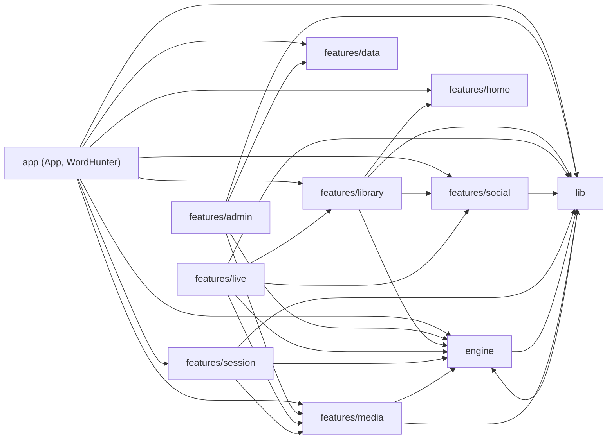
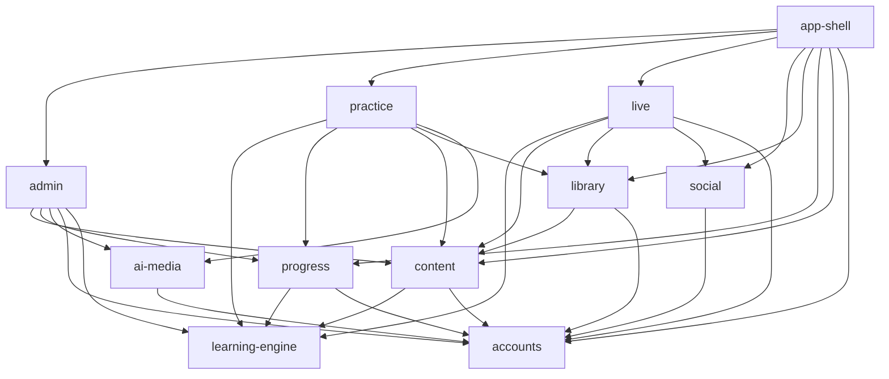

# Word Hunter: module map

Proposed module boundaries, drawn from the responsibilities that already exist in the code. Read [current-state.md](current-state.md) first for how the app works today.

**Status of this file.** The boundaries below are a **Planned** way to organise the project. Today the code is grouped by folder (`engine`, `lib`, `features/*`, `app`), and most of these modules are only partly separate. Each module has its own page under [docs/modules](../README.md) that says what is **Implemented**, what is **Planned**, and which **Known Issues** apply.

## 1. Observed dependencies today

Counted from the imports between top-level folders in `src` (number of import lines). This is what the code does now.

What this shows (**Current**):

- `app/WordHunter.jsx` imports almost everything and holds the cross-module logic.
- Cycles exist: `engine` and `lib` import each other (the repo uses the engine's mastery rules; the AI prompts in the engine call the AI client in `lib`); `live` and `social` imported each other until 2026-10-19 (social now gets the Live API from the app, for local invitations, and Live uses social's index for the add-friend button); `engine` imported `features/media` until 2026-10-19 (the picture check now runs in the content module, `MT-02`).
- `features/admin` reaches into `engine` 16 times (it edits content using engine helpers).
- `features/library` imports `features/home` and `features/social` (shared helpers and the friends list).

## 2. Proposed modules

Eleven modules. The list follows what each group of files already does; no new layers are introduced. "Today" names where the code lives now.

| Module | Responsibility | Today (main files) | Database objects it owns |
| --- | --- | --- | --- |
| `app-shell` | Start-up, route to screen, global layout, player preferences screen, global toasts and dialogs; wires the other modules together and nothing more | [App.jsx](../../src/app/App.jsx), [WordHunter.jsx](../../src/app/WordHunter.jsx) (the orchestration part), [router.js](../../src/lib/router.js), [features/shell](../../src/features/shell), [features/settings](../../src/features/settings), [appSettings.js](../../src/lib/appSettings.js) | `app_settings` (read side) |
| `accounts` | Who is signed in, their role, sign-up rules | [features/auth](../../src/features/auth), [lib/auth.js](../../src/lib/auth.js) (access token), [supabase.js](../../src/lib/supabase.js) | `profiles` (identity columns), `signup_log`, `register_player`, `is_admin`, `require_admin` |
| `content` | The shared course: words, grammar rules, challenges, stories, combos; loading, caching, saving, importing, exporting, renaming, publishing | content half of [repo.js](../../src/lib/repo.js), [engine/data.js](../../src/engine/data.js) (globals), [features/data](../../src/features/data), content editors in [features/admin](../../src/features/admin) | `content_items`, `content_meta`, `content_drafts`, `item_key_aliases`, `content_save_v2`, `apply_content_changes`, `apply_item_renames`, `dictionary_sync` |
| `learning-engine` | Pure learning rules: building questions, grading, mastery stages, evidence from a session, review steps, confusion pairs, level and badge maths | [engine/v2.js](../../src/engine/v2.js), [questions.js](../../src/engine/questions.js), [progress.js](../../src/engine/progress.js), rules in [data.js](../../src/engine/data.js), [constants.js](../../src/engine/constants.js) | none |
| `practice` | Playing: Home, session lifecycle, results, stories, speed round, study dashboard, badges, filing question reports | [features/home](../../src/features/home), [session](../../src/features/session), [results](../../src/features/results), [stats](../../src/features/stats), session handlers inside WordHunter | none (uses `progress`) |
| `progress` | A player's saved state: sections, mastery, reports sync, offline snapshot, merge across devices, backup restore, leaderboard numbers | progress half of [repo.js](../../src/lib/repo.js), the game's side in [features/progress](../../src/features/progress), [progressMerge.js](../../src/lib/progressMerge.js), [idb.js](../../src/lib/idb.js), [stableJson.js](../../src/lib/stableJson.js) | `progress`, `mastery`, `reports`, `report_tombstones`, `save_progress_v2`, `reset_my_progress`, leaderboard columns |
| `library` | Personal library, views, sharing, links, catalog, dictionary id map | [features/library](../../src/features/library) | `headwords`, `senses`, `sense_links`, `grammar_rules`, `grammar_questions`, `collections*`, `library_*`, `collection_shares`, `view_links`, `view_link_takes`, `catalog_*`, all `view_*`, `library_*`, `catalog_*` functions |
| `live` | Live Challenge: create, join, play, settle, review, rematch, realtime | [features/live](../../src/features/live) | `live_*` tables and functions |
| `social` | Friends, friend requests, leaderboard, profile, counts and badges | [features/social](../../src/features/social) | `friendships`, `live_invites`, friend functions |
| `ai-media` | Everything that calls Gemini or handles pictures and audio: prompts, quota gate, cancellation, TTS cache, image copy and resize, pronunciation UI | [api/](../../api), [lib/ai.js](../../src/lib/ai.js), [aiOperations.js](../../src/lib/aiOperations.js), [aiLifecycle.js](../../src/lib/aiLifecycle.js), [images.js](../../src/lib/images.js), [engine/ai.js](../../src/engine/ai.js), [features/media](../../src/features/media) | `ai_usage`, `ai_calls`, `ai_gate`, `ai_call_finish`, buckets `tts` and `word-images` |
| `admin` | Operating the game: analytics, players, content tools, reports, data quality, audit, app settings | [features/admin](../../src/features/admin) | `admin_*` functions, `admin_audit`, schema `analytics` |

Notes on the split:

- `content` and `progress` are the two halves of [repo.js](../../src/lib/repo.js). They share one factory today; the proposal separates them because they change for different reasons and have different writers (admin vs player).
- `learning-engine` is the pure part of the engine. [engine/ai.js](../../src/engine/ai.js) and the media import belong to `ai-media` and would leave it.
- `practice` is not a folder today. Its session logic sits inside WordHunter (handlers for starting, answering and finishing rounds; the second, unreachable copy of the old round engine was removed on 2026-10-18, `MT-03`).
- `accounts` and `app-shell` are small on purpose.

## 3. Proposed dependency direction

**Planned.** Arrows point from a module to the modules it may import. A lower module never imports a higher one.

Rules that go with the picture:

1. `learning-engine` imports nothing from the app (no React, no Supabase, no browser storage). It may keep its small pure helpers.
2. Data modules (`content`, `progress`, `library`, `live`, `social`) talk to Supabase or the local store only through their own API file. Screens never call `supabase` directly. (Today `repo.js`, `libraryApi.js`, `liveApi.js`, `friendsApi.js`, `adminApi.js` already follow this pattern. Several screens still read tables directly, for example the leaderboard and the library id map.)
3. `social` must not import `live`. Inviting friends to a challenge belongs to `live`, which depends on `social` for the friend list. (Today `friendsApi.js` imports the Live API, which creates the `live`/`social` cycle.)
4. `library` must not import `home` helpers; shared pure helpers move to a small shared place or to `content`.
5. `app-shell` is the only module that may know several feature modules at once. Cross-module logic that now lives in WordHunter (for example "start a practice round from a view") becomes a small function exposed by `practice` that takes a scope.
6. Local-mode and online implementations of one API stay in the same module and are tested against each other (as the library already does).

## 4. Public contracts to keep stable

These are the interfaces other modules and tests already depend on. Changing one needs a doc update (see [documentation rules](../README.md#documentation-rules)).

| Module | Contract today |
| --- | --- |
| `content` / `progress` | The repo interface: `loadContent`, `saveContent`, `loadProgress`, `saveProgress`, `refreshProgress`, `onMerged`, `resetProgress`, `wipeContent`, `status`, `dispose`; the progress section names and the field-to-section mapping. |
| `progress` | The RPC `save_progress_v2` shape (sections, expected revisions, mastery upserts and removes, profile numbers, `replace`) and its conflict reply. |
| `library` | The `LibraryApi` interface in [libraryApi.js](../../src/features/library/libraryApi.js); the limits and messages in [libraryRules.js](../../src/features/library/libraryRules.js). |
| `live` | The Live API interface in [liveApi.js](../../src/features/live/liveApi.js); the question and answer-key shape sent to `live_create`. |
| `social` | The friends API interface in [friendsApi.js](../../src/features/social/friendsApi.js). |
| `ai-media` | `POST /api/ai` `{prompt, task}`, `POST /api/tts` `{text}`, `POST /api/image-import` `{url}`, and the task list in [tasks.js](../../api/_lib/tasks.js). |
| `learning-engine` | The session object shape, the question shape, the mastery record shape, and `SCHEMA_VERSION` (progress file format). |
| `content` | The import and export file formats (content file, full backup, progress file) and the word key rule (the whole text is the key; text before a trailing bracket is the headword). |

Anything that a saved progress file, a backup, or an import file contains is a public contract with players' data. Changing it needs a migration path (see ADR [0004](../adr/0004-text-keys-for-words-and-progress.md)).

## 5. Where the split would start

In order of lowest risk first. Details and acceptance criteria are in [roadmap.md](roadmap.md).

1. Remove the unreachable round engine from WordHunter (no behaviour change).
2. Move the session lifecycle (`recordSessionResult`, `completeSession`, `start*`) out of WordHunter into `practice`, with tests.
3. Split the two halves of `repo.js` into `content` and `progress` behind the same interface. (Started: the content store and several progress parts are in `src/lib/repo/`, see [repo.md](repo.md).)
4. Break the `live`/`social` and `engine`/`lib` cycles.
5. Replace the mutable content globals with a content object passed down (or a read-only store). **Done** 2026-10-19: the engine takes the content as an argument and the content module keeps it ([content-catalog.md](../modules/content/content-catalog.md)).
6. Decide the progress model (text keys vs ids) and finish or drop the unused `sense_progress` / `rule_progress` tables.
