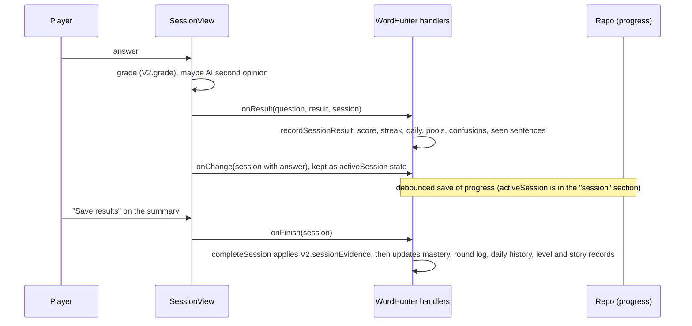

# Module: practice

Playing the game: Home, starting a round, answering, results, stories, the Speed Round, weak review, the study dashboard, badges, and reporting a bad question. Proposed boundary, see [module-map.md](../../architecture/module-map.md). Decisions: [ADR 0003](../../adr/0003-grading-location.md), [ADR 0008](../../adr/0008-session-evidence-mastery.md).

**Today this module is not a folder.** The screens are in `features/home`, `session`, `results` and `stats`. The session lifecycle (start, record each answer, finish, report) is a set of functions inside [WordHunter.jsx](../../../src/app/WordHunter.jsx). The page describes the behaviour as one module and marks where the code is still tangled.

## 1. Purpose and scope

**Purpose.** Let a player pick what to practise, answer questions, and see what they learned, while recording evidence for the learning rules.

**Responsibilities (Implemented)**

- Home: three views of the same material, chosen in Settings or by tab: **By lesson** (each lesson, with its units), the player's biggest personal views as tabs, and **Gateway** (course levels and sessions; shown to the admin only). A player sees only words and rules in their own library; the admin sees the whole course.
- Starting rounds: a lesson, a unit, a course level, a personal view (with or without the views inside), weak review, Final Case, a story, the Speed Round.
- The session screen: one question at a time, hints, "don't know", report a question, AI second opinion on typed answers, "Save and leave", resume.
- Per-answer recording and end-of-round recording (see section 5).
- Results: round summary, speed results, final report.
- Stories (play; the admin builds them), badges, daily goal, study dashboard.
- Question reports: file, review with AI, withdraw; reported word and mode pairs are kept out of new rounds until resolved. Rules, state and operations are in [features/reports](../../../src/features/reports) (guide: [question-reports.md](question-reports.md)).

**Out of scope**

- The rules themselves ([learning-engine](../learning-engine/README.md)), including how a round's questions are picked and ordered ([practice-selection.md](../learning-engine/practice-selection.md)).
- Saving ([progress](../progress/README.md)); personal views ([library](../library/README.md)); competition ([live](../live/README.md)).
- The admin's report handling ([admin](../admin/README.md)).

## 2. Public operations

These are user actions today, not exported functions.

| Operation | Input | Result |
| --- | --- | --- |
| Start a round (`startLevel`, `startCourseLevel`, `startViewPractice`, `startItemsPractice`) | a lesson, group, course level, view id or item list | an active session; the app opens `/play`. An empty view gives a message instead. |
| Start weak review | none | up to the "weak review size" words with the weakest evidence, each in a mode chosen for its weakness. |
| Start Final Case | a level the player has at least one star in | a three-word typed session. |
| Start a story | a story | a session of its questions; the best result per story is kept. |
| Start the Speed Round | none; needs at least 5 mastered words | a timed session (Settings: 30 to 120 s) of short multiple-choice questions from mastered words. |
| Answer | a choice, text or ordering | a graded result; for typed answers a wrong result may be re-judged by AI first. |
| Hint / "don't know" / report | button | marks the answer assisted / wrong without AI / files a report. |
| Save and leave / Resume | button | keep the active session; Home shows a Resume button. |
| Save results and review | button on the summary | applies mastery evidence (once) and shows the answers. |

## 3. Files, screens and database objects

- Home: [HomeTabs](../../../src/features/home/HomeTabs.jsx), [LessonsView](../../../src/features/home/LessonsView.jsx), [CourseLevelsView](../../../src/features/home/CourseLevelsView.jsx), [StageCard](../../../src/features/home/StageCard.jsx), [homeState.js](../../../src/features/home/homeState.js) (pure decisions: which tab, what a player sees), [MyViewsHome](../../../src/features/library/components/MyViewsHome.jsx) (read-only personal views).
- Session: [SessionView](../../../src/features/session/SessionView.jsx), results: [ResultScreens](../../../src/features/results/ResultScreens.jsx), study dashboard: [StudyDashboard](../../../src/features/stats/StudyDashboard.jsx) with [studyStats.js](../../../src/features/stats/studyStats.js).
- Question reports: [reportRules.js](../../../src/features/reports/reportRules.js) (pure rules) and [useQuestionReports.js](../../../src/features/reports/useQuestionReports.js) (state and operations), used by the shell through [features/reports/index.js](../../../src/features/reports/index.js).
- In WordHunter: `startPractice`, `launchSession`, `recordSessionResult`, `completeSession`, `startWeakReview`, `startFinalCase`, `startSpeedRound`, `triggerGeneration`, `triggerVariantGeneration`.
- Database: none of its own. Data is saved by [progress](../progress/README.md) in the sections `core`, `session`, `pools`, `seen`, `confusions`, `history`, `levels`, `reports` and in `mastery`.

## 4. Business rules and permissions

- Round size, new words per round, weak review size, daily goal and Speed Round seconds come from the player's settings. New-word intake follows the last round in the same place: 90% or better earns two extra new words; under 60% holds back two (never below one unless the setting is 0).
- Score: +10 for each independent correct answer; answer streak resets on a miss or an assisted answer. Daily goal: a toast appears the first time the number is reached; more is a bonus.
- A question's sentences are remembered (newest 4,000) and avoided for about 20 hours. Words whose gap sentences are all used get new ones written in the background.
- An answer is recorded once per question (key: session id and index), even if the player retries the screen.
- Reported, unverified, AI-failed and "no telemetry" answers are not recorded. Speed Round answers count for the daily total but give no mastery evidence.
- Home for a player shows only items in their own library. Gateway is the owner's (admin's) view and falls back to By lesson for anyone else.
- All AI features used here are player-allowed tasks: check a written answer, check another word in a gap, explain a wrong answer, review a reported question, Grammar Court, new combo or grammar question, write and check new practice sentences, Final Case report. Story writing is admin-only.

## 5. Data flow

- **Load.** On start the active session, pools, seen sentences, history and mastery come from [progress](../progress/README.md). Home is built from the content lists and, for players, the library keys.
- **Save.** Nothing here calls the network directly except AI features. State changes trigger the debounced progress save.
- **Mastery timing.** Mastery changes only in `completeSession`, called from the summary buttons (and when a Speed Round ends). Closing the app on the summary leaves the session open with all answers; Resume shows the summary again.

## 6. Failure, retry, cancel, offline

- Offline: rounds, grading without AI and saving to the local snapshot all work. AI checks fail: a wrong typed answer is simply marked wrong, a free-writing answer shows "AI failed" with a Retry button and is excluded from evidence.
- AI calls have a 45 s request timeout and a 50 s job timeout, show progress, and are cancelled when the player leaves the question or the screen.
- Leaving mid-round keeps the session (score and streak for answered questions are already counted; mastery waits). A session that finished (`completed`) or whose id is already in `completedSessions` cannot be applied again.
- A story or round with no safe question explains that nothing is available yet.
- A hidden or closed page flushes the pending save.

## 7. Tests

| Check | Where |
| --- | --- |
| Home view choice and limiting to the library | [tests/home-state.test.js](../../../tests/home-state.test.js), [tests/home-components.test.jsx](../../../tests/home-components.test.jsx), [tests/my-views-home.test.jsx](../../../tests/my-views-home.test.jsx), [e2e/specs/homeviews.cjs](../../../e2e/specs/homeviews.cjs) |
| Course levels | [tests/course-levels.test.js](../../../tests/course-levels.test.js) |
| Result screens | [tests/result-screens.test.jsx](../../../tests/result-screens.test.jsx) |
| Report window | [tests/report-modal.test.jsx](../../../tests/report-modal.test.jsx) |
| Question report rules and the reports hook (AI review mocked) | [question-reports-rules.test.js](../../../tests/question-reports-rules.test.js), [question-reports-hook.test.jsx](../../../tests/question-reports-hook.test.jsx) |
| File a report in a round; the admin resolves, reopens, deletes it (browser) | [e2e/specs/reports.cjs](../../../e2e/specs/reports.cjs) |
| Study dashboard numbers | [tests/study-stats.test.js](../../../tests/study-stats.test.js) |
| AI progress and cancellation while answering | [tests/ai-progress.test.jsx](../../../tests/ai-progress.test.jsx), [tests/ai-timeout.test.js](../../../tests/ai-timeout.test.js), [tests/listening-background.test.jsx](../../../tests/listening-background.test.jsx) |
| Practice from a library view, grammar-only views | [e2e/specs/library.cjs](../../../e2e/specs/library.cjs), [e2e/specs/libgrammar.cjs](../../../e2e/specs/libgrammar.cjs) |
| Whole app, a few questions played | [e2e/specs/sweep.cjs](../../../e2e/specs/sweep.cjs) |

**Gaps (important).** `recordSessionResult` and `completeSession` have no unit test: once-only recording, mastery timing, resume after a closed tab, and the behaviour of "Save and leave" are checked only through the engine's own tests and the browser sweep. No test covers the weak-review mode choice, Final Case, or the Speed Round end. `MT-04`.

## 8. Example journey

Omar (synthetic player) opens the game, taps "Practise" on the card for his view "Travel".

1. The app asks the library for the view's contents, maps ids to word keys, and builds a 12-question round from those words; wrong options still come from the whole dictionary.
2. He answers eight questions; each one adds 10 points when right, updates the streak, today's total and the sentence record. He types a wrong word in a gap sentence: the app asks the AI whether it also fits; it says no; the answer is marked wrong. (Confusion pairs are counted only for wrong multiple-choice answers, so none is recorded here.)
3. He closes the browser. The session (with answers) is already in the local snapshot and, a moment later, on the server.
4. Next day he taps "Resume Travel (9/12)", finishes, and presses "Save results & review". Now each word gets one scored result; two words reach Learned; the round log and the daily total are updated.
5. If he had pressed "Hint" on one word in that round, that word's round would count as a miss.

## 9. Status

**Implemented.** Everything above.

**Planned** (roadmap)

- Phase 0: tests for the session lifecycle.
- Phase 2: one definition of "mastered"; a rule for unreviewed AI sentences.
- Phase 4: remove the unreachable old round engine; extract the session lifecycle from WordHunter into this module.

**Known Issues**

- `LC-01` grammar items use a simpler "mastered" rule than words.
- `LC-02` AI-written practice sentences can reach a pool without a review when the quality check is unavailable.
- `LC-03` score and streak change per answer; mastery per finished round.
- `MT-03` an unreachable `playing` screen and its handlers remain in WordHunter.
- `MT-04` the session lifecycle is untested at unit level.
- `DP-02` words cannot be added by a player; "Add to Collection" in Ask AI is admin-only.
- Reports (found when the reports code was moved, not fixed): after "Reset progress" the reports list in memory is not cleared until a reload; `retire` on a report whose `poolType` is not a known pool would throw (Admin only offers it for reports with a pool). Details: [question-reports.md](question-reports.md#old-problems-found-not-fixed-here).
